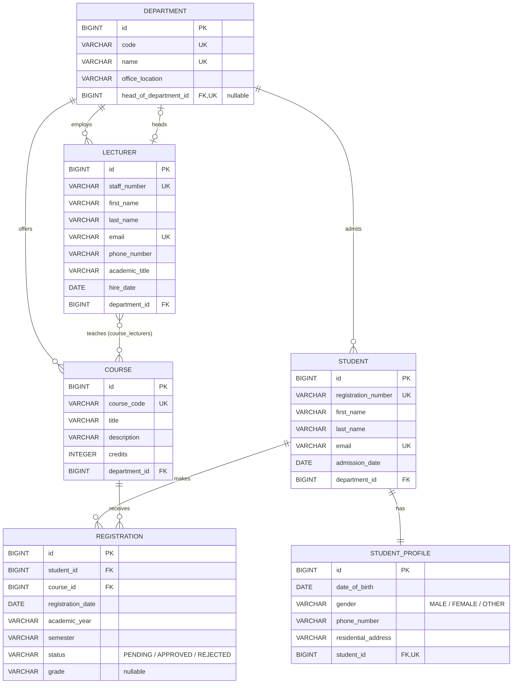
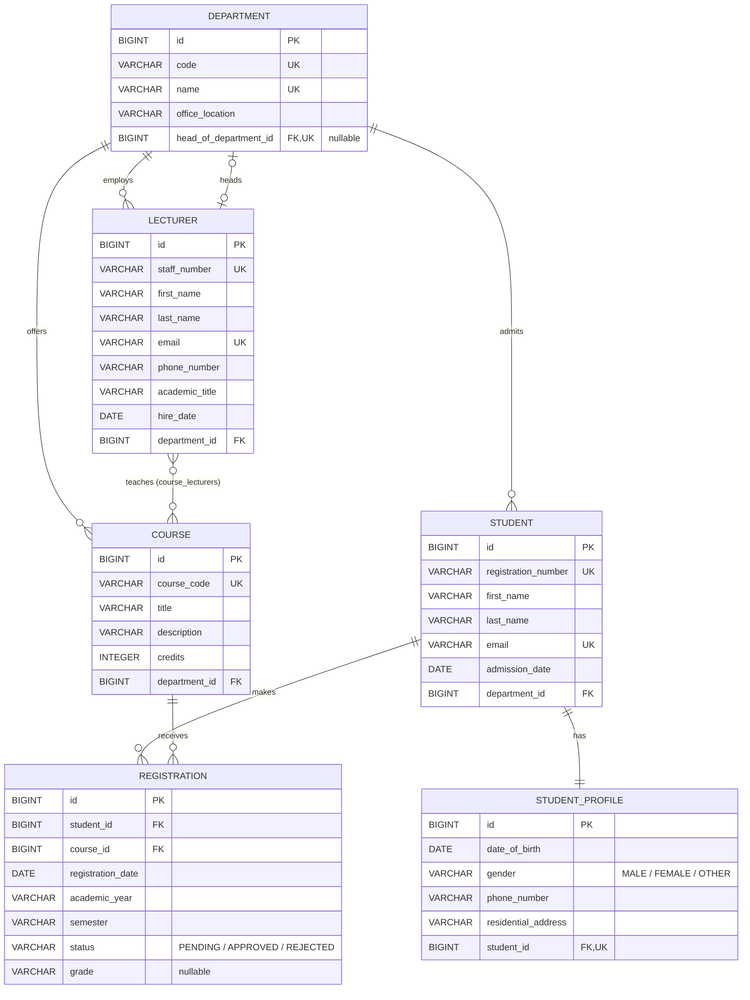

# Entity Relationship Diagram

The same diagram as Mermaid (GitHub renders it automatically):

**Legend (crow's foot):** `||` exactly one · `o|` zero or one · `o{` zero or many · `}o--o{` many-to-many.

- `course_lecturers` is the join table for Lecturer–Course (no entity).
- `REGISTRATION` is the join entity that resolves Student–Course many-to-many.
