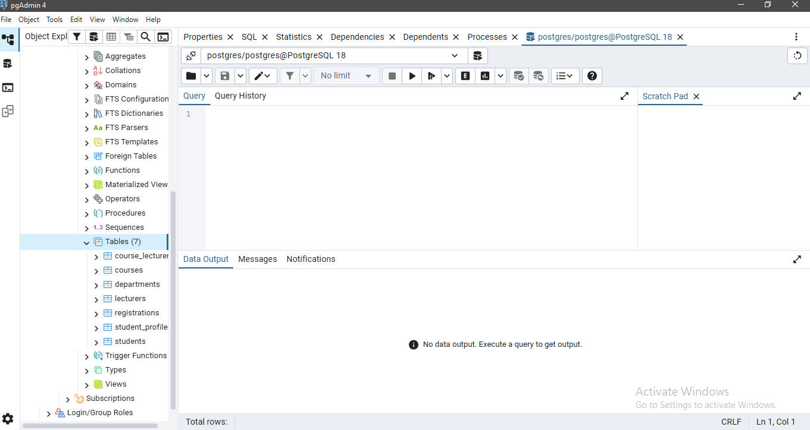
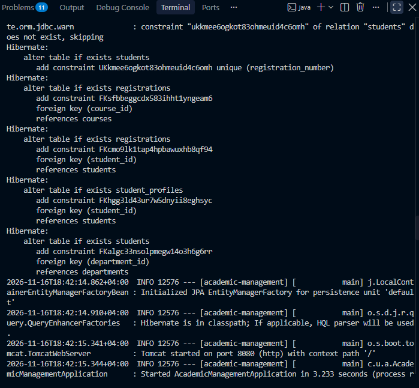
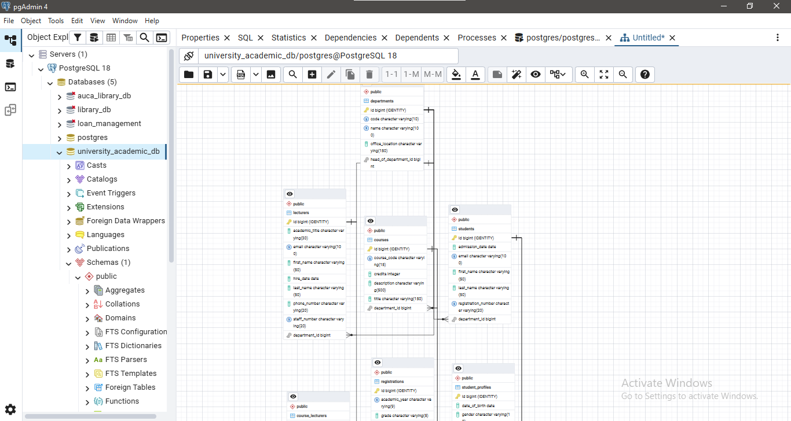
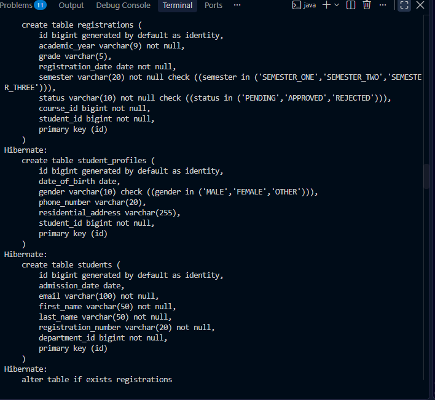

# University Course Registration and Academic Management System

**Course:** Web Technology and Internet — Individual Assignment
**Student:** GISA Miguel — Reg. No: 27332

Spring Boot · Spring Data JPA / Hibernate · PostgreSQL (`university_academic_db`) · Maven · Java 17+

## Contents
| Deliverable | Where |
|---|---|
| Problem analysis and identified entities | [ANALYSIS.md](ANALYSIS.md) |
| Entity Relationship Diagram | [ERD.md](ERD.md) / [ERD.png](ERD.png) |
| Relational database schema | [ANALYSIS.md – section 7](ANALYSIS.md#7-relational-database-schema) |
| Source code | `src/main/java/com/university/academic` |
| Screenshots | [screenshots/](screenshots/) |

## Project structure
```
src/main/java/com/university/academic
├── model/        Department, Lecturer, Student, StudentProfile, Course, Registration + enums
├── repository/   One JpaRepository per entity
└── config/       DataSeeder (sample data used to test the mappings)
```

## Relationships implemented
| Relationship | Type | Annotation |
|---|---|---|
| Department – Course | 1 : N | `@OneToMany` / `@ManyToOne` + `@JoinColumn(department_id)` |
| Department – Lecturer (employs) | 1 : N | `@OneToMany` / `@ManyToOne` + `@JoinColumn(department_id)` |
| Department – Lecturer (head) | 1 : 1 | `@OneToOne` + `@JoinColumn(head_of_department_id, unique)` |
| Department – Student | 1 : N | `@OneToMany` / `@ManyToOne` + `@JoinColumn(department_id)` |
| Student – StudentProfile | 1 : 1 | `@OneToOne` + `@JoinColumn(student_id, unique)` |
| Lecturer – Course | M : N | `@ManyToMany` + `@JoinTable(course_lecturers)` |
| Student – Course | M : N via join entity | `Registration` with two `@ManyToOne` |

## How to run
1. Create the database: `CREATE DATABASE university_academic_db;`
2. Set your PostgreSQL username/password in `src/main/resources/application.properties`.
3. Run `./mvnw spring-boot:run` (Windows: `.\mvnw.cmd spring-boot:run`).
4. Hibernate (`ddl-auto=update`) creates the 7 tables and `DataSeeder` inserts sample data.

## Screenshots
### Generated tables

### Application startup / table generation

### Relationships (ERD from pgAdmin / data)

### Tables created by Hibernate
